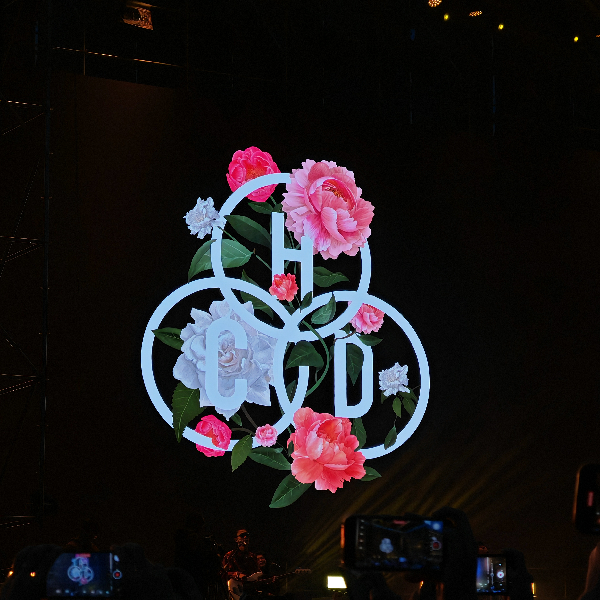

<div align="center">

# ⚡ Hello, I'm 24

[](https://git.io/typing-svg)

<p align="center">
  
  
  
</p>

<p align="center">
  
  
  
  
</p>

</div>

---

### 🥊 About Me

<div align="center">

```text
┌──( 24㉿redteam )-[ ~/whoami ]
└─$ cat profile.json
```

```json
{
  "operator": "24",
  "affiliation": "24team",
  "current_focus": "Code Audit & Offensive Security",
  "arsenal": {
    "operations": [
      "Red Team Engagement",
      "Intranet Penetration",
      "Physical / Near-Source Assessment",
      "Adversary Emulation & Social Engineering"
    ],
    "weaponization": [
      "Shellcode Evasion & Immunity",
      "Custom Exploit / POC Development",
      "Offensive Tooling Engineering"
    ],
    "frontier": [
      "AI Security & LLM Vulnerability",
      "Sec Vibe Coding / AI Agent Engineering"
    ]
  },
  "motto": "Offense informs defense; silence breeds precision."
}
```

<p align="center">
  
  
  
  
</p>

</div>

---

### 📌 Pinned Projects

<div align="center">

| Project | Description | Tech | Stars | Forks |
| :--- | :--- | :---: | :---: | :---: |
| <nobr>🚀 **[fscan-POC](https://github.com/24-2021/fscan-POC)**</nobr> | 强化 fscan 的漏扫 POC 库，红队武器库必备 | `POC / Go` |  |  |
| <nobr>🔍 **[Finger24](https://github.com/24-2021/Finger24)**</nobr> | 基于已收集指纹库进行识别网站指纹的浏览器插件 | `JavaScript` |  |  |
| <nobr>📱 **[24adbspy](https://github.com/24-2021/24adbspy)**</nobr> | ADB 未授权批量检测与控制管理系统 | `JavaScript` |  |  |
| <nobr>🌐 **[Proxy24](https://github.com/24-2021/Proxy24)**</nobr> | 一个简单的代理浏览器插件，攻防调度便利 | `JavaScript` |  |  |
| <nobr>💥 **[EXP-POC](https://github.com/24-2021/EXP-POC)**</nobr> | 汇总平时写的一些高价值 POC & EXP 资产库 | `Python / Security` |  |  |
| <nobr>🪓 **[BOF24](https://github.com/24-2021/BOF24)**</nobr> | 实战攻防中用到的 Beacon Object Files (BOF) 集合 | `C / RedTeam` |  |  |

</div>

---

### 🛡️ CVE

<div align="center">

<p>
  <a href="https://nvd.nist.gov/vuln/detail/CVE-2025-14004"></a>
  <a href="https://nvd.nist.gov/vuln/detail/CVE-2025-14005"></a>
  <a href="https://nvd.nist.gov/vuln/detail/CVE-2025-14006"></a>
  <a href="https://nvd.nist.gov/vuln/detail/CVE-2025-14007"></a>
  <a href="https://nvd.nist.gov/vuln/detail/CVE-2025-14008"></a>
</p>

<p>
  <a href="https://nvd.nist.gov/vuln/detail/CVE-2025-14011"></a>
  <a href="https://nvd.nist.gov/vuln/detail/CVE-2025-14012"></a>
  <a href="https://nvd.nist.gov/vuln/detail/CVE-2025-14013"></a>
  <a href="https://nvd.nist.gov/vuln/detail/CVE-2026-1107"></a>
</p>

</div>

---

### 📊 GitHub Streak Activity

<div align="center">

<p align="center">
  
</p>

</div>

---

### 🛠️ Tech Stack & Skills

<p align="center">
  
</p>

---

### 💖 Love

<div align="center">



</div>

<div align="center">

<br/>

[](https://git.io/typing-svg)

</div>